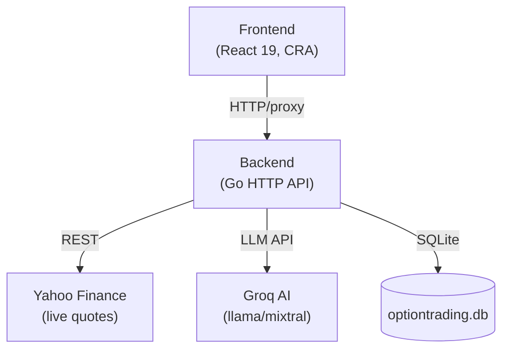

# Option Seller — Project Analysis

## Overview

**Option Seller** is a full-stack web application for US options traders. It helps traders:
- Plan **campaigns** (structured trading programs)
- Define reusable **trade approaches** (strategy rules, risk management parameters)
- Manage **watchlists** of US stocks
- Screen **AI-powered opportunities** using live market data
- Follow **live market data** (quotes, price history, SSE streams)

---

## Architecture



---

## Stack

| Layer | Technology |
|---|---|
| **Frontend** | React 19, React Router 7, Create React App |
| **Auth** | Google OAuth (`@react-oauth/google`) |
| **Backend** | Go 1.26, stdlib `net/http` |
| **Database** | SQLite (pure-Go `modernc.org/sqlite`, no CGO needed) |
| **Quotes** | Yahoo Finance (unofficial scraping) |
| **AI** | Groq API (chat completions, structured JSON output) |
| **Proxy** | `http-proxy-middleware` in CRA dev server |

---

## Backend (`backend/`)

### Packages

| Package | Purpose |
|---|---|
| `cmd/server` | Entry point — wires everything together, starts HTTP server |
| `internal/api` | HTTP handlers & routing |
| `internal/approaches` | Trade approach domain model, validation, CRUD repository |
| `internal/insights` | AI screener — Groq LLM integration, metrics computation, caching |
| `internal/market` | US market calendar, trading session status |
| `internal/quotes` | Live quotes & history from Yahoo Finance, in-memory caching |
| `internal/store` | SQLite open/migrate, WAL mode |
| `internal/config` | Config loaded from env vars |

### API Routes

```
GET  /api/health
GET  /api/market/status
GET  /api/market/quote/{symbol}?series=1
GET  /api/market/quotes?symbols=AAPL,MSFT,...  (up to 50)
GET  /api/market/history/{symbol}?range=1D|1W|1M|3M|6M|1Y|3Y|5Y|ALL
GET  /api/market/stream?symbols=...             (Server-Sent Events)
GET/POST/PUT/DELETE /api/approaches/...
POST /api/screener/ask
```

### Notable Design Decisions

- **Pure-Go SQLite** (`modernc.org/sqlite`) — no CGO, easy cross-compilation.
- **WAL mode + single connection** — SQLite writers serialize; WAL allows concurrent reads.
- **Sequential migrations** — append-only `[]string` tracked by `PRAGMA user_version`.
- **Layered caching** — `quotes.Service` caches TTL-based quotes; `insights.Service` caches LLM responses for 10 minutes per `symbol|question` key to respect Groq rate limits.
- **Bounded concurrency** — `GetMany` fans out with an 8-slot semaphore.
- **SSE streaming** — `/api/market/stream` pushes live quote updates without WebSocket overhead.
- **AI screener** — structured JSON prompt; robust `parseAnswer` that strips markdown fences and handles typographic hyphens.

---

## Frontend (`frontend/src/`)

### Architecture Pattern: MVC-ish

The src folder is intentionally organized into MVC layers:

| Folder | Role |
|---|---|
| `View/Pages/` | Page-level components (9 pages) |
| `View/Components/` | Reusable UI components (15 component groups) |
| `View/Assets/` | Static assets |
| `Controller/` | Custom React hooks, context providers |
| `Model/` | Data models / types |
| `Data/` | Static/seed data |
| `Utils/` | Utility functions |

### Pages

| Route | Page |
|---|---|
| `/` | Landing page (not lazy-loaded) |
| `/dashboard` | Dashboard |
| `/campaigns` | Campaigns list |
| `/opportunities` | AI opportunity screener |
| `/watchlist` | Watchlists |
| `/trade-approaches` | Trade approach library |
| `/stocks/:symbol` | Stock detail with chart |
| `/ask-ai` | Ask-AI chat interface |
| Placeholder | positions, trade-log, notifications, settings |

### Notable Design Decisions

- **Code splitting** — all pages except Landing are `lazy()`-loaded with `<Suspense>` + skeleton fallbacks.
- **Auth** — `AuthProvider` wraps the entire app; Google OAuth via `@react-oauth/google`.
- **Market context** — `MarketStatusProvider` polls the backend for US market open/close status and broadcasts it app-wide.
- **SSE hooks** — `useLiveQuote` / `useLiveQuotes` subscribe to the backend's SSE stream for real-time price updates.
- **Proxy** — `setupProxy.js` routes `/api/*` to `localhost:8085` in dev.

---

## Key Flows

### 1. AI Opportunity Screener
```
User asks question → POST /api/screener/ask
  → insights.Service.Analyze(symbol, question)
    → quotes.Service.Get(symbol)            (TTL-cached)
    → quotes.Service.History(symbol, 1Y)    (TTL-cached)
    → computeMetrics(quote, history)        (IV proxy, trend, returns)
    → Groq LLM complete(systemPrompt, userPrompt)
    → parseAnswer(JSON)
    → cache result 10 min
  ← Analysis{rating, outlook, reasons, risks, optionIdea, metrics, disclaimer}
```

### 2. Live Quote Stream
```
Frontend useLiveQuotes(symbols)
  → GET /api/market/stream?symbols=AAPL,MSFT (SSE)
    → goroutine polls quotes every N seconds
    → sends JSON events per symbol
  ← EventSource.onmessage → React state update
```

### 3. Trade Approach CRUD
```
POST /api/approaches
  → approaches.Input.Normalize()
  → approaches.Input.Validate()  (field-level errors map)
  → approaches.Repository.Create(db)
  ← Approach{id, name, strategies, …}
```

---

## Strengths

- ✅ Clean separation of concerns (Go packages map 1:1 to domain concepts)
- ✅ Pure-Go SQLite — zero native dependency, trivial deployment
- ✅ Responsible AI use — 10-min cache, rate-limit-safe, disclaimer on every response
- ✅ Structured LLM output — enforced JSON schema with validation and fallbacks
- ✅ Code-split frontend — good performance, skeleton loaders for UX
- ✅ SSE for live data — lightweight, no WS complexity
- ✅ Test files present for most packages

## Potential Gaps / Areas to Explore

> [!NOTE]
> These are observations from code structure — not confirmed bugs.

- **Campaigns page** — frontend route exists but backend has no `/api/campaigns` endpoint visible in `api.go`; likely a planned/stub feature.
- **Positions / Trade Log / Notifications** — rendered as `PlaceholderPage`; not yet implemented.
- **Auth enforcement on backend** — no JWT/token middleware visible in backend routes; backend may be auth-free or auth happens only at the frontend.
- **Yahoo Finance** — unofficial API; subject to breakage or rate limiting without notice.
- **Single-user assumption** — SQLite + single connection suggests this is a single-user/personal tool, not multi-tenant.
- **No persistence for watchlists** — watchlists are likely stored in frontend state or localStorage (no backend endpoint seen).
